<div align="center">



<br/>

<a href="https://git.io/typing-svg">
  
</a>

<br/><br/>

<a href="mailto:anferomol@pm.me"></a>
<a href="https://github.com/Anferomol"></a>

</div>

<br/>

<div align="center">
  
</div>

<br/>

## 🌲 About me

```ts
const anferomol = {
  passion:      "The world of IT 👨‍💻",
  currently:    "Learning new languages and leveling up my code 🌱",
  lookingFor:   "Good ideas worth building together 🔥",
  mindset:      "I'm on the way — and enjoying every step",
  reachMe:      "anferomol@pm.me 📫",
};
```

<br/>

## 🏔️ Tech stack

<div align="center">


</div>

<br/>

## 🌅 GitHub in numbers

<div align="center">

<picture>
  <source media="(prefers-color-scheme: dark)" srcset="https://github-readme-stats.vercel.app/api?username=Anferomol&show_icons=true&hide_border=true&bg_color=0b1619&title_color=d4914f&icon_color=6f9a7a&text_color=c9d6cc&ring_color=d4914f&rank_icon=github&include_all_commits=true&count_private=true" />
  
</picture>
<picture>
  <source media="(prefers-color-scheme: dark)" srcset="https://github-readme-stats.vercel.app/api/top-langs/?username=Anferomol&layout=compact&hide_border=true&bg_color=0b1619&title_color=d4914f&text_color=c9d6cc&langs_count=6" />
  
</picture>

<br/>

<picture>
  <source media="(prefers-color-scheme: dark)" srcset="https://streak-stats.demolab.com?user=Anferomol&hide_border=true&background=0b1619&ring=2c6a5f&fire=d4914f&currStreakLabel=d4914f&sideLabels=c9d6cc&currStreakNum=f3e6cc&sideNums=f3e6cc&dates=5f7d76&stroke=1b3d3d" />
  
</picture>

</div>

<br/>

## 🌊 Let's build something

<div align="center">

**Got an idea that keeps you up at night?** I'd love to hear it.

<a href="mailto:anferomol@pm.me">
  
</a>

<br/><br/>


</div>
